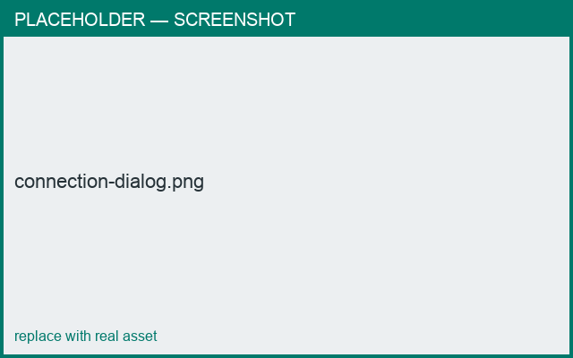

# Connecting parts

*What you'll learn: attach a part to the body and position it.*

When a part can attach more than one way, a **connection dialog** lets you pick:

- **Connection type** — e.g. *Top → Bottom (plane)*, *Bottom → Surface*, *Top+Bottom → Surface*.
- **Attach to** — which existing part is the target.

Common cases:
- **Base / Lid** stack plane-to-plane (one end meets a flat plane of the body).
- **Handle** welds **both ends to the surface** (*Top+Bottom → Surface*).
- **Spout** attaches one end to the surface.

## Positioning on the surface
For surface-attached parts, drag the part in the **3D** view to set its height
(location along the body) and angle (around the body).

<figure markdown>
  { width="520" }
  <figcaption>Choosing how a part connects.</figcaption>
</figure>
