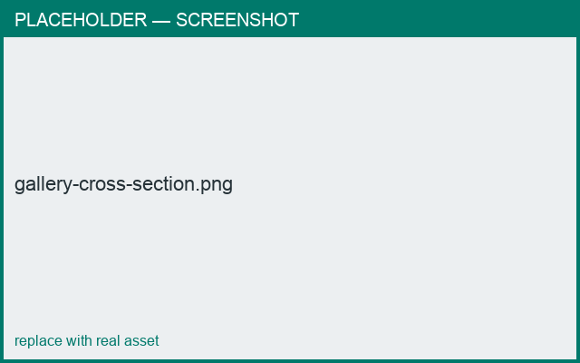

# Galleries & lids

*What you'll learn: make a lid seat correctly on a body with an interlocking gallery.*

A **gallery** is the stepped/angled joint where a lid meets the body so it sits without
sliding off. Pick a gallery type in the connection editor (e.g. *Gallery Vessel*), and set
its angle and leg length.

- The gallery leg length defaults proportionally to the body's rim.
- Use the connection editor's cross-section preview to see the joint.

<figure markdown>
  { width="560" }
  <figcaption>A V-gallery interlocking a lid and body.</figcaption>
</figure>

!!! tip
    See the full recipe: **[Make a lidded teapot](../cookbook/teapot.md)**.
