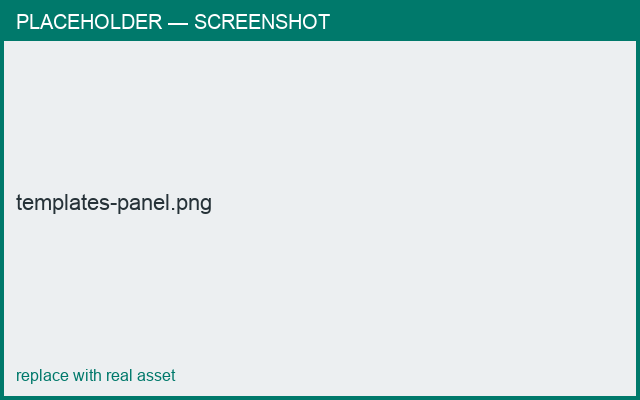

# Templates & parts

*What you'll learn: start from a template and add parts.*

## New from template
Pick a ready-made object (Cup, Bowl, Teapot, …) to start, then edit it.

## The Templates panel
Add parts — **Handle, Lid, Base, Dish, Spout, Stamp** — from the templates panel.

=== "Android"
    Open the **Templates** panel, choose a part, tap **Add**.

=== "macOS"
    Open the **Templates** panel, select a part, click **Add**.

When you add a part, a **connection dialog** may open so you can choose how it attaches —
see [Connecting parts](connections.md).

<figure markdown>
  { width="680" }
  <figcaption>Adding a handle from the templates panel.</figcaption>
</figure>
