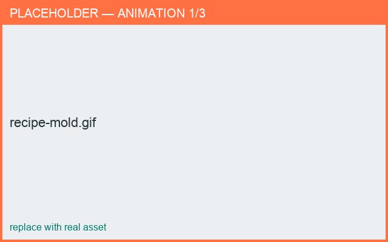

# Recipe: Make a slip-casting mold

*Result: printable mold parts for slip-casting your design.*

**Time:** ~6 min · **You'll use:** export, molds, scale.

1. Open or build the piece you want to cast.
2. Decide the casting workflow:
    - **Mold** — print the negative and slip-cast directly.
    - **Negative mold** — print a master, cast plaster working-molds from it, then slip-cast.
3. In **Export**, choose the mold option and generate the mold parts.
4. Review the split pieces (halves, base, gallery) with alignment **keys** and the pouring **reservoir**.
5. Set the **scale**, allowing for clay **shrinkage** so the finished cast lands at the intended size.
6. **Export** each part to STL and slice for your printer bed.

<figure markdown>
  { width="680" }
  <figcaption>From design to printable mold parts.</figcaption>
</figure>

!!! warning "Shrinkage"
    Clay shrinks as it dries and fires. Oversize the mold so the cast piece ends up the
    size you want.

**Go deeper:** [Molds & slip casting](../exporting/molds.md) ·
[Scale & bed fit](../exporting/scale.md)
