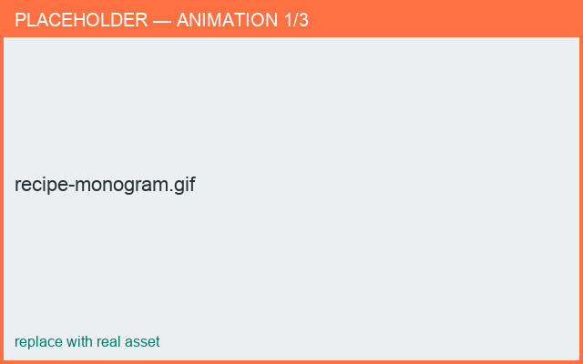

# Recipe: Add a monogram stamp

*Result: a piece decorated with wrapped initials that follow its curve.*

**Time:** ~4 min · **You'll use:** stamps, placing & scaling.

1. Open or build the piece you want to decorate.
2. Open the **Templates** panel and **Add ▸ Stamp**, then attach it to the body surface.
3. In the stamp editor, set **Text** to your initials and pick a **Font**.
4. Set **Raised** for a sprig-like relief, or **Recessed** for a pressed-in mark.
5. In **3D**, drag the stamp **up/down** to set its height and **around** the body to set its angle.
6. Drag a **corner handle** of the relief box to size the monogram.
7. Set the in-plane **rotation** so the lettering sits straight.
8. **Save**, then **Export Prototype** → STL.

<figure markdown>
  { width="680" }
  <figcaption>Initials wrapped to follow the surface curve.</figcaption>
</figure>

!!! tip "It follows the curve"
    The text bends along the cylindrical surface — position, scale, and rotation all stay
    wrapped to the body as you adjust them.

**Go deeper:** [Text stamps](../stamps/text.md) ·
[Placing & scaling](../stamps/placing.md)
