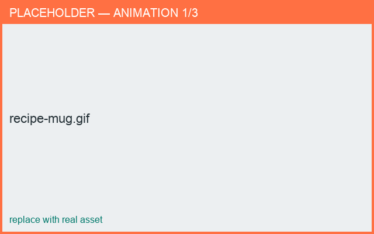

# Recipe: Make a mug with a handle

*Result: a mug body with a curved handle, ready to export.*

**Time:** ~5 min · **You'll use:** templates, profile editor, connections.

1. **New from Template ▸ Cup** (or **Simple**).
2. In **Edit ▸ Profile**, shape the body — drag the top point outward for a wider rim.
3. Open the **Templates** panel and **Add ▸ Handle**.
4. In the connection dialog, choose **Top+Bottom → Surface** and attach to the body.
5. In **3D**, drag the handle to set its height and angle.
6. (Optional) In **Edit ▸ Cross Section**, flatten the handle's cross-section.
7. **Save**, then **Export Prototype** → STL.

<figure markdown>
  { width="680" }
  <figcaption>From template to finished mug.</figcaption>
</figure>

**Go deeper:** [Profile editor](../designing/profile-editor.md) ·
[Connecting parts](../building/connections.md) · [Export STL](../exporting/stl.md)
