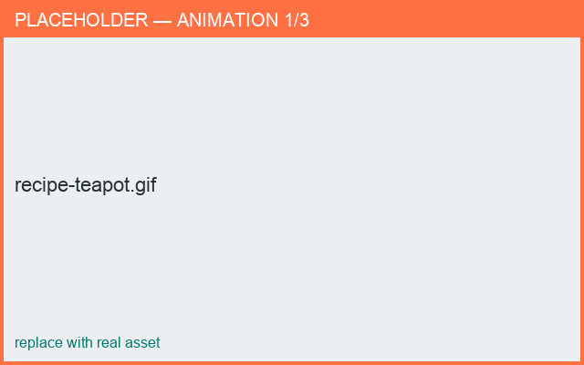

# Recipe: Make a lidded teapot

*Result: a teapot with a seated lid (gallery), spout, and handle.*

**Time:** ~10 min · **You'll use:** templates, connections, galleries.

1. **New from Template ▸ Teapot** for a full starting point, or build up from a body.
2. Add a **Lid**; in the connection editor choose a **Gallery** so the lid seats on the body.
3. Tune the **gallery** angle and leg length in the connection cross-section preview.
4. Add a **Spout** and a **Handle**, then position each in **3D**.
5. Check the lid fit in **Wire cutting** / cross-section.
6. **Export Prototype** and choose pieces (body + lid) in the dialog.

<figure markdown>
  { width="680" }
  <figcaption>Lid, gallery, spout, and handle.</figcaption>
</figure>

**Go deeper:** [Galleries & lids](../building/galleries.md) ·
[Connecting parts](../building/connections.md) · [Export STL](../exporting/stl.md)
