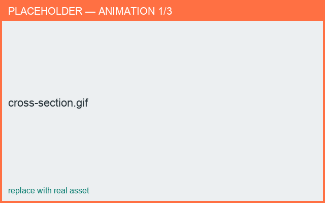

# Cross-section

*What you'll learn: give a part a non-round cross-section (flat/oval/custom handle).*

By default parts are round. The **Cross Section** tab lets you draw a closed 2D shape that
is swept along the part — ideal for flat or oval handles.

## Editing
- Tap empty space to create a starter circle; drag points to reshape.
- Tap a segment to add a point; double-tap a segment to toggle straight/curved.
- Drag the whole shape to rotate it; it re-centers on release.

<figure markdown>
  { width="620" }
  <figcaption>A flat handle cross-section.</figcaption>
</figure>

!!! note "Saved with the project"
    Custom cross-sections are stored in the project file and travel between the Android and
    macOS apps.
