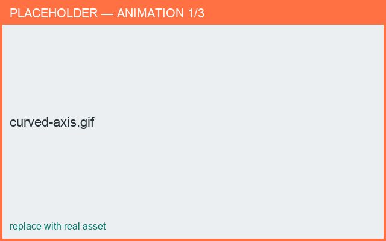

# Curved axis

*What you'll learn: bend a part along a curved centerline (e.g. an S-shaped handle).*

In side view, the blue dashed **axis** curve bends the part away from a straight vertical
spine. Drag the blue axis points (end points stay fixed); double-tap a segment to toggle
straight/curved.

<figure markdown>
  { width="620" }
  <figcaption>Curving the axis to sweep a handle.</figcaption>
</figure>

!!! note
    The axis is most useful for swept parts like handles. Round bodies usually keep a
    straight axis.
