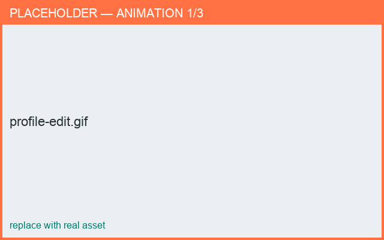

# Profile editor

*What you'll learn: shape a part's silhouette with Bézier control points.*

The profile is the 2D curve revolved around the vertical axis to form the part.

## Editing points
- **Add** a point: tap/click on the curve.
- **Move** a point: drag it. Moving a point raises/lowers everything above it.
- **Delete** a point: double-tap/double-click it (end points can't be deleted).
- **Handles**: drag a point's orange handles to curve the segment; double-tap a segment to
  toggle straight/curved.

## Width (radius)
Drag the **left** curve to scale the whole width; a small orange dot marks the drag hint.

## Zoom & pan
Pinch/scroll to zoom, drag empty space to pan. Point hit-testing follows the zoom.

<figure markdown>
  { width="640" }
  <figcaption>Editing the profile curve.</figcaption>
</figure>

## Next
- [Curved axis](curved-axis.md) · [Cross-section](cross-section.md)
