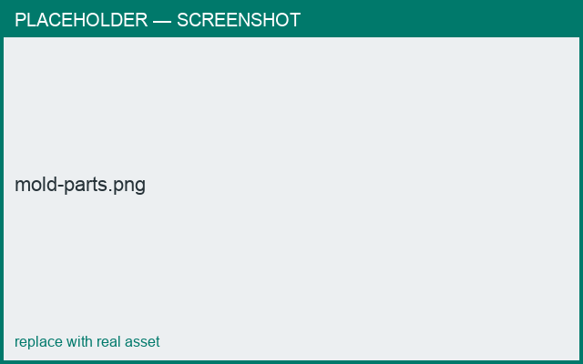

# Molds & slip casting

*What you'll learn: generate casting molds from your design.*

Besides printing the ware itself, you can produce **casting molds**:

- **Mold** — a single-stage casting mold (the negative used directly to slip-cast the piece).
- **Negative mold** — a master for **2-stage** casting: print the negative, cast plaster
  working-molds from it, then slip-cast the final ware.

Mold parts are split into separate printable pieces (e.g. halves, base, gallery) with
alignment **keys** and a pouring **reservoir**.

<figure markdown>
  { width="640" }
  <figcaption>A two-part casting mold.</figcaption>
</figure>

!!! warning "Shrinkage"
    Account for clay shrinkage when choosing mold scale, so the cast piece ends up the
    intended size.

!!! tip
    Full recipe: **[Make a slip-casting mold](../cookbook/casting-mold.md)**.
