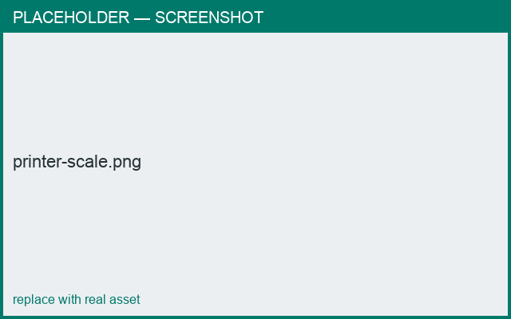

# Scale & bed fit

*What you'll learn: scale the export and fit parts to your printer bed.*

## Export scale
Set an **export scale** (20%–200%). The exported STL is scaled by this factor — 50% makes a
model half the original size.

## Bed size & splitting
Enter your printer's **build volume**. Parts larger than the bed are split/tiled to fit.
Scaling is applied **before** the fit check, so a part that fits after scaling is **not**
split.

!!! example
    A 300 mm part, bed 250 mm, scale 50% → effective size 150 mm → fits → no split.

<figure markdown>
  { width="520" }
  <figcaption>Export scale and build-volume settings.</figcaption>
</figure>

!!! note "Platform"
    The dedicated **Printer** tab with build-volume and export-scale inputs is in the
    desktop mold tooling; see your app's export options for the equivalent controls.
