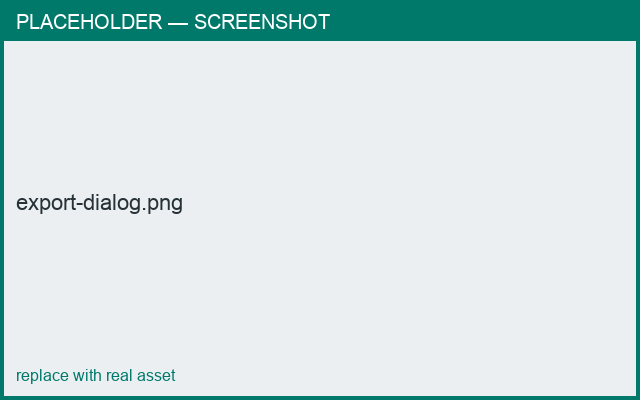

# Export STL

*What you'll learn: export your ware as a printable STL.*

Use **Export Prototype** to write an STL of the object. If the object has separable pieces
(e.g. a teapot's body and lid), a dialog lets you choose which pieces to include; each is
laid out as its own printable solid.

- Mesh errors are repaired automatically so the result is watertight.
- A progress spinner shows while the STL is built.

=== "Android"
    The system **Save** dialog lets you choose the filename and location.

=== "macOS"
    The **Save** panel lets you choose the filename and location.

<figure markdown>
  { width="520" }
  <figcaption>Choosing which pieces to export.</figcaption>
</figure>

## Next
- [Scale & bed fit](scale.md) · [Molds & slip casting](molds.md)
