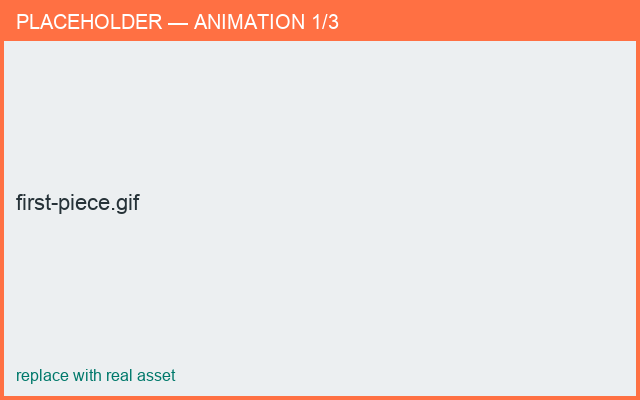

# Your first piece

*What you'll learn: make a simple cup from a template in a couple of minutes.*

1. Open **New from Template** and pick **Cup** (or **Simple**).
2. In **Edit ▸ Profile**, drag a point to change the silhouette.
3. Rotate the **3D** view to see the result.
4. **Save** your project (see [Save & open](../files/save-open.md)).

<figure markdown>
  { width="640" }
  <figcaption>From template to edited cup.</figcaption>
</figure>

!!! tip
    Want something with a handle? Follow the cookbook recipe
    **[Make a mug with a handle](../cookbook/mug-with-handle.md)**.
