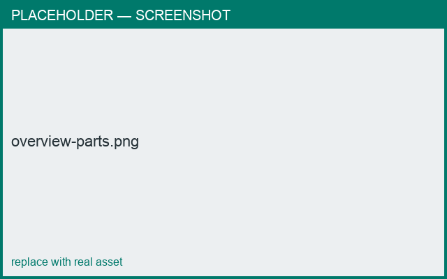

# Overview

*What you'll learn: what Pottery Wheel is, the core ideas, and how a project is organized.*

## The idea
Pottery Wheel builds 3D tableware from a 2D **profile** spun around an axis (a surface of
revolution), the same way a potter throws on a wheel. You then add **parts**, **decorations**,
and export for printing or casting.

## Key concepts
- **Part** — one piece of the object (belly/body, lid, knob, handle, spout, base, stamp).
- **Profile** — the 2D curve that is revolved to form a part's surface.
- **Cross-section** — the shape perpendicular to a part (round by default; custom for handles).
- **Connection** — how a part attaches to another (plane-to-plane, or point-to-surface).
- **Gallery** — the interlocking joint between a lid and a body.
- **Stamp / appliqué** — text or an STL relief applied to the surface.

<figure markdown>
  { width="640" }
  <figcaption>The parts of a teapot: belly, lid, knob, spout, handle.</figcaption>
</figure>

!!! note "Placeholder"
    Screenshots and animations referenced on this page are to be captured. See the asset
    list in the repo `README.md`.

## Next
- [Install & open](install.md)
- [The workspace](workspace.md)
