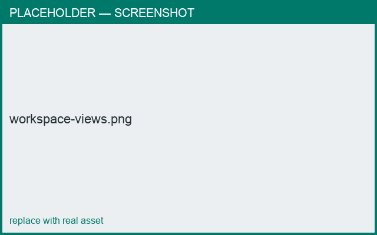

# The workspace

*What you'll learn: the main views and how to move around them.*

## Views
- **3D** — rotate/zoom the assembled object; select a part by tapping/clicking it.
- **Edit** — the 2D editors: profile, cross-section, and the connection editor (tabs).
- **Wire cutting** / **Info** — cross-section-at-angle and part details.

=== "Android"
    Switch views from the **bottom navigation bar**. The build number shows at the
    bottom-right of the nav bar.

=== "macOS"
    Switch views from the **nav bar** / menu bar. The window title bar hosts the toolbar
    (folder menu, settings, undo/redo).

<figure markdown>
  { width="700" }
  <figcaption>3D, Edit, and Wire-cutting/Info views.</figcaption>
</figure>

## Navigating the 3D view
- Rotate: drag. Zoom: pinch / scroll. Select a part: tap/click it.

## Next
- [Your first piece](first-piece.md)
