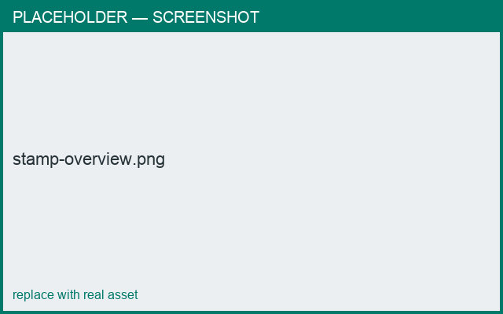

# Stamps & reliefs — overview

*What you'll learn: what a stamp is, the two kinds, and how they sit on the surface.*

A **stamp** (also called an *appliqué*) is a decoration applied to a part's surface. There
are two kinds, added as separate items:

- **Text** — a monogram or word, rendered as beveled 3D letters.
- **Relief** — an imported **STL** sprig (e.g. a laurel leaf), applied to the surface.

Text and relief are **separate** items, so you place each on its own — and you can overlap
a text and a relief in the same spot if you want both.

Stamps **curve along the surface** — the decoration wraps around the body following its
curvature, rather than sitting flat like a sticker — and you can **scale, rotate, and
position** them.

<figure markdown>
  { width="640" }
  <figcaption>Text and relief stamps wrapped onto the curved surface.</figcaption>
</figure>

## How a stamp is added
1. Add a **Text** or **Relief** item from the [Templates panel](../building/templates.md).
2. Connect it to the body's surface (point-to-surface).
3. Set its content — the text editor for a Text item, the relief dialog for a Relief — then
   drag it in the **3D** view to position it and drag a **corner handle** to resize.

## Raised vs recessed
A stamp can stand **out** of the surface (raised) or press **into** it (recessed).

## Where to go next
- [Text stamps](text.md)
- [STL reliefs](reliefs.md)
- [Placing & scaling](placing.md)
