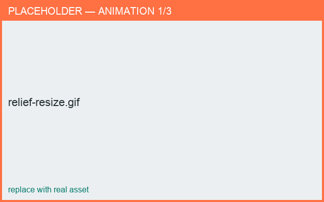

# Placing & scaling

*What you'll learn: position, rotate, and resize a stamp on the surface.*

## Position on the surface
In the **3D** view, drag the stamp to move it:

- **Up/down** the body changes its height (location).
- **Around** the body changes its angle.

## Scale
Select the stamp in the **3D** view: a selection box appears with **corner handles**. Drag
a corner handle to resize the stamp — it scales from its center and updates live on the
surface.

=== "Android"
    Touch and drag a **corner handle**. (You can also open the stamp editor and use the size
    slider, or pinch to scale.)

=== "macOS"
    Click and drag a **corner handle**. A plain drag on the stamp body moves it instead; no
    modifier key is needed to resize.

<figure markdown>
  { width="620" }
  <figcaption>Resizing a stamp by its corner handles in the 3D view.</figcaption>
</figure>

## Rotate
Set the stamp's in-plane rotation so the decoration sits at the angle you want on the
surface.

## Raised vs recessed
Choose **Raised** (stands out — for applied sprigging) or **Recessed** (pressed in — for a
stamped/incised look).

!!! tip "It follows the curve"
    Scale, rotation, and position all respect the surface curvature, so the stamp stays
    wrapped to the body as you adjust it.
