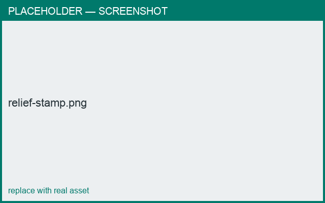

# STL reliefs

*What you'll learn: apply an imported relief (sprig) to the surface.*

A **relief** is a 3D sprig supplied as an **STL** file (for example a laurel leaf). With a
stamp selected, enable **Relief** and choose an asset.

The relief is placed on the surface and **wraps around the body's curve**, standing out
(raised) or pressing in (recessed) like a text stamp.

<figure markdown>
  { width="620" }
  <figcaption>A relief sprig applied to the surface.</figcaption>
</figure>

## Authoring your own relief
A relief STL is read as a flat sprig:

- Its **X/Y** is the design plane (the shape you see head-on).
- Its **+Z** is the relief depth (how far it stands out).

Keep the design roughly centered; the app normalizes and scales it to the stamp size.

!!! note "Where reliefs come from"
    The app ships with a few reliefs. The relief source is designed as a **pluggable
    engine** that outputs an STL — so future engines (including image-to-relief) can add
    new sprigs without changing how stamps work.

## Next
- [Placing & scaling](placing.md)
