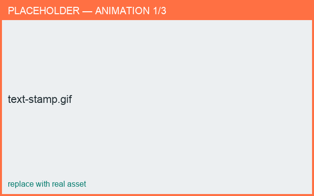

# Text stamps

*What you'll learn: add a monogram or word and style it.*

With a stamp selected, open the stamp editor and enable **Text**.

## What you can set
- **Text** — the characters to show.
- **Font** — Serif, Sans Serif, Monospace, and others.
- **Bold / Italic** — style toggles.
- **Raised / Recessed** — stand out of, or press into, the surface.

The text is extruded into 3D letters and **wraps around the curved surface** so it reads
correctly on the body.

<figure markdown>
  { width="620" }
  <figcaption>Editing a text stamp.</figcaption>
</figure>

## Tips
!!! tip "Keep monograms short"
    1–3 characters read best on a curved mug or cup; long words wrap a long way around.

!!! note "Placement & size"
    Scale and position are shared with relief stamps — see
    [Placing & scaling](placing.md).
